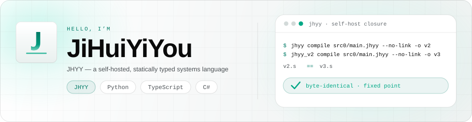
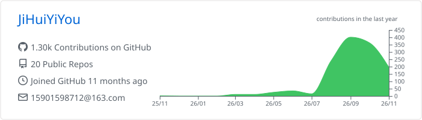
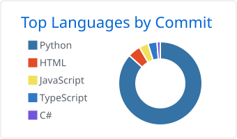
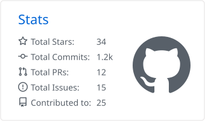
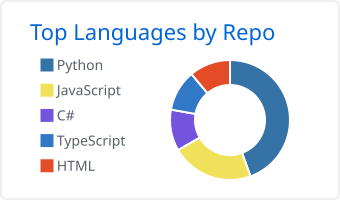
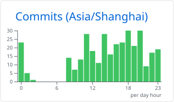

  <picture>
    <source media="(prefers-color-scheme: dark)" srcset="./assets/header-dark.svg">
    
  </picture>

  

  <a href="https://github.com/JiHuiYiYou/JiHuiYiYou-compiler"><strong>JHYY Compiler ↗</strong></a> 
  
  
  
   
  A self-hosted, statically typed systems language — the compiler is written in itself and reproduces itself byte-for-byte · <a href="https://jihuiyiyou.github.io/JiHuiYiYou-website/">Website</a>

  Now — v4.1.5 shipped · the microkernel OS is still a spike · ARM Cortex-A9 backend for the VEX V5 Brain

<table>
  <tr>
    <th width="200">01 / COMPILER</th>
    <th width="200">02 / IDE</th>
    <th width="200">03 / OS</th>
    <th width="200">04 / VEX</th>
  </tr>
  <tr>
    <td align="center" width="200">
      <a href="https://github.com/JiHuiYiYou/JiHuiYiYou-compiler"><strong>JHYY Compiler</strong></a>  
      A self-hosted systems language with a hand-written amd64 backend — no LLVM, no QBE, no GC.
    </td>
    <td align="center" width="200">
      <a href="https://github.com/JiHuiYiYou/JiHuiYiYou-IDE"><strong>JHYY IDE</strong></a>  
      Drag-block programming and full text editing over one shared AST, with Claude Code built in.
    </td>
    <td align="center" width="200">
      <a href="https://github.com/JiHuiYiYou/JiHuiYiYou-OS"><strong>JiHuiYiYou-OS</strong></a>  
      A co-designed microkernel OS — amd64, UEFI, capability-based, written in JHYY.
    </td>
    <td align="center" width="200">
      <a href="https://github.com/JiHuiYiYou/JiHuiYiYou-for-VEX"><strong>JiHuiYiYou-for-VEX</strong></a>  
      JHYY compiled to the VEX V5 Brain (ARM Cortex-A9) — signed binary format, softfp ABI, struct layouts.
    </td>
  </tr>
</table>

  <picture>
    <source media="(prefers-color-scheme: dark)" srcset="./profile-summary-card-output/github_dark/0-profile-details.svg">
    
  </picture>

  <picture>
    <source media="(prefers-color-scheme: dark)" srcset="./profile-summary-card-output/github_dark/2-most-commit-language.svg">
    
  </picture>
  <picture>
    <source media="(prefers-color-scheme: dark)" srcset="./profile-summary-card-output/github_dark/3-stats.svg">
    
  </picture>

  
More activity

  

    <picture>
      <source media="(prefers-color-scheme: dark)" srcset="./profile-summary-card-output/github_dark/1-repos-per-language.svg">
      
    </picture>
    <picture>
      <source media="(prefers-color-scheme: dark)" srcset="./profile-summary-card-output/github_dark/4-productive-time.svg">
      
    </picture>
  

  
    <a href="https://jihuiyiyou.github.io/JiHuiYiYou-website/">Website</a> ·
    <a href="https://github.com/JiHuiYiYou/JiHuiYiYou-compiler/releases/latest">Releases</a> ·
    <a href="https://github.com/JiHuiYiYou/JiHuiYiYou-compiler">Source</a>
  

