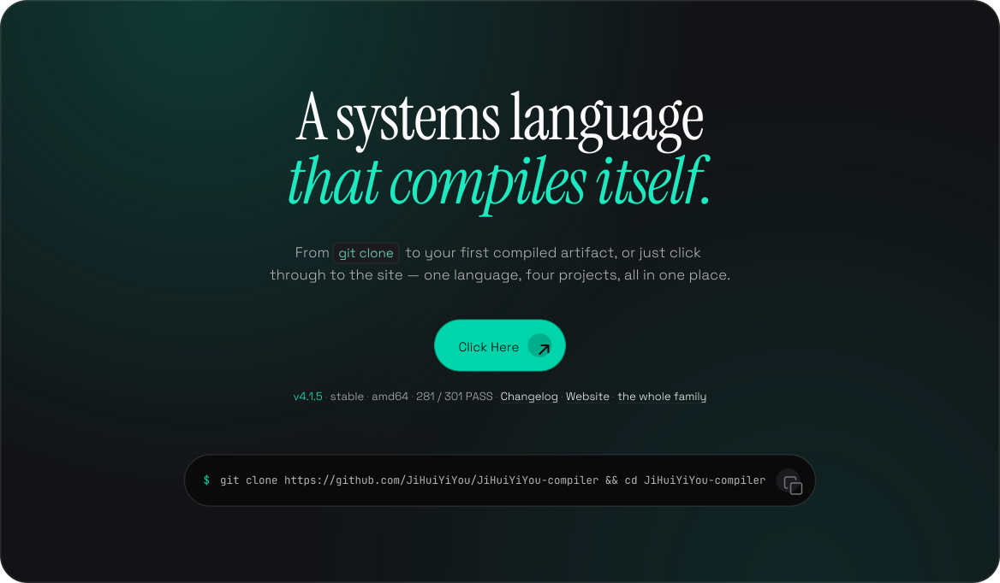

<h1 align="center">
  <a href="https://jihuiyiyou.github.io/JiHuiYiYou-website/">
    <picture>
      <source media="(prefers-color-scheme: dark)" srcset="./assets/header-dark.svg">
      
    </picture>
  </a>
</h1>

  

  <picture>
    <source media="(prefers-color-scheme: dark)" srcset="./profile-summary-card-output/github_dark/0-profile-details.svg">
    
  </picture>

  <picture>
    <source media="(prefers-color-scheme: dark)" srcset="./profile-summary-card-output/github_dark/2-most-commit-language.svg">
    
  </picture>
  <picture>
    <source media="(prefers-color-scheme: dark)" srcset="./profile-summary-card-output/github_dark/3-stats.svg">
    
  </picture>

  
More activity

  

    <picture>
      <source media="(prefers-color-scheme: dark)" srcset="./profile-summary-card-output/github_dark/1-repos-per-language.svg">
      
    </picture>
    <picture>
      <source media="(prefers-color-scheme: dark)" srcset="./profile-summary-card-output/github_dark/4-productive-time.svg">
      
    </picture>
  

  
    <a href="https://jihuiyiyou.github.io/JiHuiYiYou-website/">Website</a> ·
    <a href="https://github.com/JiHuiYiYou/JiHuiYiYou-compiler/releases/latest">Releases</a> ·
    <a href="https://github.com/JiHuiYiYou/JiHuiYiYou-compiler">Source</a>
  

